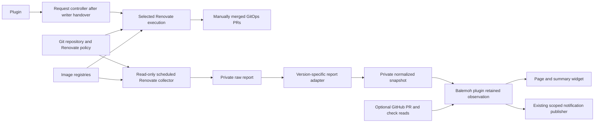

# Renovate installation and advisory integration

Status: read-only homelab deployment, 2026-11-01. Selected provider scope is Renovate only. Recommended installation is the OSS container in Kubernetes CronJob. The advisory deployment is active; no writer migration has occurred. See [implementation receipt](https://github.com/guilycst/home-lab/blob/0b0a6ae801053f4c0458cdf66d50ced0fb9f855c/docs/specs/spec-001-balemoh-image-upgrades/implementation.md) for local code, tests and rollout gates.

The [report PoC has now executed](https://github.com/guilycst/home-lab/blob/0b0a6ae801053f4c0458cdf66d50ced0fb9f855c/docs/specs/spec-001-balemoh-image-upgrades/poc-results.md). An image-manager full dry-run returned 190 raw image records and 82 candidate entries with exit zero, while retaining partial/error coverage. It validates positive advisory data and the need for conservative parsing, not a clean-coverage or deployment guarantee.

## 1. Installation choice

The first product is a Balemoh page/widget showing Git image dependencies, available Renovate candidates, policy/workflow evidence and collection age, with optional inbox notifications. It does not promise runtime inventory or rollout proof.

For this journey, run one pinned Renovate OSS image as a Kubernetes CronJob. Keep `renovate.json` as repository policy. The collector remains read-only. After a separate writer migration, an on-demand request controller runs the same pinned engine for one approved candidate. See [selected upgrade requests](upgrade-requests.md) and [writer migration](https://github.com/guilycst/home-lab/blob/0b0a6ae801053f4c0458cdf66d50ced0fb9f855c/docs/specs/spec-001-balemoh-image-upgrades/writer-migration.md). A report adapter publishes a bounded private snapshot for the plugin. No Renovate REST server is required for this initial advisory journey.

Community Edition is a reasonable choice when built-in webhooks/queuing and native execution APIs become the main requirement. It does not currently expose the complete dependency/update dashboard needed here. Enterprise Edition has that API, but would introduce a commercial dependency for a one-repository feature. See [feasibility.md](feasibility.md) for the edition evidence and comparison.

GitHub Actions is the alternative execution location if CI should own the job and a future workflow-dispatch trigger. It does not improve the report's data contract. Kubernetes is recommended because this repository already operates scheduled workloads and private in-cluster services through Argo CD.

## 2. Components and trust boundaries

| Component | Access |
| --- | --- |
| Renovate job | Dedicated bot Git/PR rights after migration; registry reads; no Kubernetes mutation or automatic merge. |
| Report adapter/publisher | Read one run's report, publish only its artifact prefix. No independent Git writer. |
| Plugin backend | Read normalized snapshot and optional GitHub metadata. No bot write token, registry credential, Docker socket or Kubernetes credential. |
| Plugin UI | Scoped retained queries and optional explicit service presentation. No source credentials. |

The source API is the documented file report, converted to our proposed versioned [snapshot contract](snapshot.schema.json). File/object publication is a normal data integration. The adapter owns version mapping and validation; it must not parse debug logs, reimplement version selection, scrape UI, read private Renovate cache databases or rewrite dashboard Markdown. The PoC showed that datasource filtering alone admits OCI charts, and that dependency records do not carry container/resource identity. Use the reviewed image-manager profile and file/image groups described in the main spec.

The [report spec](spec-001-balemoh-image-upgrades.md) defines identities, freshness, unknown/excluded coverage, query behavior and notification semantics. Preserve those contracts. Source-specific details remain in the plugin repository, not in Balemoh core.

## 3. Kubernetes operating model

One repository/base branch per scheduled job is the initial supported scope. Proposed schedule is hourly, with `concurrencyPolicy: Forbid`, finite run deadline, resource limits and exact image digest. The selected release and mixed-node image support still need verification. A CronJob avoids adding a long-running queue/API server for the advisory MVP.

Use a dedicated GitHub App/bot identity with explicit repository scope. Manage configuration and sealed credential references through GitOps. Keep source credentials out of artifacts, logs and plugin/browser configuration. A source exporter needs write access only to its own private artifact prefix; the plugin gets separate read access. Private registry reads become possible with self-hosted credentials but remain disabled until explicitly configured and tested.

Cache is a performance optimization and can be rebuilt. The last valid normalized snapshot is retained independently so failed jobs leave readable stale data. The initial design does not require a new application database. The initial implementation retains one atomic snapshot on existing disposable RWX NFS storage, exposed through an authenticated private TLS endpoint. Raw reports/logs stay on transient Job volumes. It adds no object-store credentials or new database. Storage access, lock behavior and certificate rotation still require live rollout checks.

`concurrencyPolicy: Forbid` serializes scheduled read-only collection. The request controller uses one worker and a lifetime durable-store lock for selected writes. Collector and writer have separate temporary workspaces and credentials; the collector never gains a writer mode. Do not create writer Jobs from the collector CronJob.

## 4. Migration from the current hosted bot

The current hosted bot remains the sole writer during the proof. Run the new collector only in full dry-run with credentials that cannot write Git/PRs/issues. This collector remains the plugin's read-only discovery engine after handover.

An authorized migration must inventory current branches, PR authors, approvals and dashboard state before switching. Preserve policy and registry exclusions, then disable the old writer for this repository before enabling the new writer. Changing bot identity can affect ownership of old branches/PRs; choose explicit handover versus close/recreate behavior after inspecting current state. No automatic adoption is promised.

First validate normal PR creation plus report export in an isolated repository. After migration, observe the first in-app request, resulting PR, generated inventory requirements and exact-head CI behavior. Application rollback must disable the new writer before reenabling the hosted one. Keep automerge disabled throughout.

This document selects an installation for the proposed plugin; it does not authorize changing bot ownership, GitHub App settings or cluster resources.

## 5. Advisory operation

Read-only source behavior includes listing image dependencies/candidates, showing collection coverage, linking associated PRs/dashboard/files and optionally reading GitHub check state. Notifications write only to Balemoh's separately granted inbox publisher. Notification receipt is not a PR approval or a deployment signal.

Refresh means refreshing plugin observations. It does not start Renovate, approve a dependency or modify a repository. The current SDK `backend.Handler.Query` is read-only; future actions need an explicit action contract rather than side effects hidden inside a query.

A newer image is not evidence of a security fix. Renovate's vulnerability integrations do not scan container layers/OS packages. Image-scanner enrichment is outside this selected single-backend scope.

### Hosted-bot PR request findings, 2026-11-01

The requested next action must ask the existing hosted Renovate bot to create the PR. Balemoh must not create a branch or PR itself, and the full-dry-run collector retains its read-only credential. No write action has been implemented or deployed at this checkpoint.

The supported hosted workflow is a checkbox in Renovate's [Dependency Dashboard](https://docs.renovatebot.com/key-concepts/dashboard/). Read-only inspection found open dashboard issue #170, authored by `renovate[bot]`. All 19 native branches in the retained diagnostic report had an exact dashboard marker match at inspection time. This cross-time comparison demonstrates matching feasibility, not freshness or permission to execute any upgrade.

The dashboard contained `approve-branch`, `unlimit-branch`, `unpend-branch` and `rebase-branch` markers. They represent different operations. Approval, overriding a PR limit, overriding pending checks and rebasing must not share a generic "Open PR" confirmation. A branch may contain several dependency upgrades, including changes outside this image-only collector's scope. An action must identify the whole native branch and explain its effect; an image name or PR title is insufficient identity.

No supported per-candidate request API for the existing hosted installation was established. A programmatic checkbox edit would replace the issue body. GitHub documents that [conditional requests for unsafe methods are unsupported unless an endpoint explicitly says otherwise](https://docs.github.com/en/rest/using-the-rest-api/best-practices-for-using-the-rest-api#use-conditional-requests). Live GraphQL schema inspection also found no revision precondition in `UpdateIssueInput`. Reading twice, comparing a body hash or using a local lock cannot prevent an intervening bot/user edit from being overwritten. Do not present those approaches as atomic updates.

The subsequent product decision is for Balemoh to own approval and tracking, with Renovate used as an execution engine and its dashboard disabled. The [isolated PR execution proof](https://github.com/guilycst/home-lab/blob/0b0a6ae801053f4c0458cdf66d50ced0fb9f855c/docs/specs/spec-001-balemoh-image-upgrades/pr-request-poc-results.md) passed for one selected Kubernetes tag upgrade, including exact diff, repeat-request behavior and real Balemoh report association. The hosted production bot was not changed. The [explicit mutation contract and durable request controller](upgrade-requests.md) are now implemented and [validated in isolation](https://github.com/guilycst/home-lab/blob/0b0a6ae801053f4c0458cdf66d50ced0fb9f855c/docs/specs/spec-001-balemoh-image-upgrades/request-controller-results.md). No write runs through `Query`, and no second production writer is enabled. A production handover and broader selection/lifecycle qualification remain separate gates. Never report "PR created" before observing an actual associated PR.

## 6. Optional future execution API

The OSS CLI is an executable, not a REST service. If a later version needs an operator action to request processing, use an owned execution endpoint/scheduler or GitHub Actions workflow dispatch. That operation has separate authorization, idempotency, serialization and job-result semantics. It can run the repository without guaranteeing one specific PR or creating it immediately.

If native job APIs and webhooks become important enough to warrant a service, reevaluate [Mend CE's job API](https://github.com/mend/renovate-ce-ee/blob/main/docs/openapi-community.yaml). It adds execution control but does not remove the dependency-report adapter. If avoiding experimental report data is the priority, evaluate [EE's repository dashboard API](https://github.com/mend/renovate-ce-ee/blob/main/docs/openapi-enterprise.yaml), with a selected release and license.

Renovate's [checkedBranches](https://docs.renovatebot.com/self-hosted-configuration/#checkedbranches) is experimental and represents administrator consent for branch creation/rebase. It can bypass release-age/internal-check gating, so it is not a refresh option or part of the advisory MVP. Branches can group several upgrades. This setting must never become a permanent approval bypass.

## 7. Maturity and acceptance

Pre-v0.1.0, trusted repository and operator-installed plugin. Current entry gates are report completeness/unknown semantics, real release pinning, normal-run artifact proof and SDK compatibility. Native execution API, enterprise installation, distributed collection, durable notification delivery and runtime inventory are not prerequisites.

Accept the full advisory journey only when a selected Renovate release produces candidates, the adapter preserves evidence/unknown states and a matching Balemoh host renders page/widget and optional notifications without extra source work per browser request. Read-only deployment and isolated selected-writer validation have executed. Production writer migration, broader manager qualification and retained-state restore remain separate gates. No gateway or credential from the local PoC is proposed as production infrastructure.
