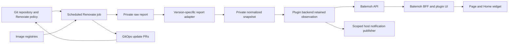

# Spec 001: Balemoh image upgrades

Status: read-only homelab deployment, pre-v0.1.0. Date: 2026-11-01. Plugin-specific contracts below have an implementation and a verified real collection. See [implementation receipt](https://github.com/guilycst/home-lab/blob/0b0a6ae801053f4c0458cdf66d50ced0fb9f855c/docs/specs/spec-001-balemoh-image-upgrades/implementation.md) for tested behavior and resolved SDK constraints.

Report PoC executed with Renovate `44.197.0`: candidate and workflow fields are usable under an explicit image-manager profile; coverage, stable declaration identity and runner provenance require the conservative rules below. See [executed results](https://github.com/guilycst/home-lab/blob/0b0a6ae801053f4c0458cdf66d50ced0fb9f855c/docs/specs/spec-001-balemoh-image-upgrades/poc-results.md). The report proof is separate from the local implementation and rollout gates recorded in the implementation receipt.

Selected scope: Renovate only, with the OSS container scheduled by Kubernetes CronJob as the proposed installation. The same managed job will own GitOps PR creation and report production after an approved writer migration. The plugin remains advisory. See [installation and integration design](advisory-design.md). The read-only deployment is active. The hosted writer remains unchanged.

## Overview

An independently compiled `araihu.image-upgrades` plugin shows container-image update candidates found by Renovate in configured Git repositories. Users see current Git references, proposed tags/digests, policy evidence, optional PR links and collection coverage. Optional notifications announce newly observed candidates through Balemoh's existing inbox.

This spec assumes the producer gates in [feasibility.md](feasibility.md) pass. The baseline is one trusted repository, one scheduled Renovate job, one API backend owner and one BFF. It makes no deployment or release authorization.

## Related documents

- [Feasibility, source revisions and alternatives](feasibility.md).
- [Executed report PoC and limitations](https://github.com/guilycst/home-lab/blob/0b0a6ae801053f4c0458cdf66d50ced0fb9f855c/docs/specs/spec-001-balemoh-image-upgrades/poc-results.md).
- [Local implementation and validation receipt](https://github.com/guilycst/home-lab/blob/0b0a6ae801053f4c0458cdf66d50ced0fb9f855c/docs/specs/spec-001-balemoh-image-upgrades/implementation.md).
- [Home-lab upgrade operations](https://github.com/guilycst/home-lab/blob/0b0a6ae801053f4c0458cdf66d50ced0fb9f855c/docs/runbooks/dependency-upgrade-operations.md).
- [Home-lab Renovate policy](https://github.com/guilycst/home-lab/blob/0b0a6ae801053f4c0458cdf66d50ced0fb9f855c/renovate.json).
- [Balemoh plugin operator contract](https://github.com/araihu/balemoh/blob/2b82350fbfc0e3c3c00abb03bde3f9f65a3cd499/docs/plugins/operations.md).
- [Pending notification service references, PR #56](https://github.com/araihu/balemoh/pull/56).

## 1. User journey and scope

User opens Image upgrades or pins its summary widget. Each row identifies repository, file, manager, image, Git reference and candidate. Opening a row shows evidence and a validated link to its PR or Dependency Dashboard when available. Filters cover repository, image, update type, assessment and workflow state.

Coverage remains visible beside counts. For example, "4 candidates; 2 dependencies unassessed" is valid. "All images up to date" is not valid when only PRs, selected files or partial extraction were observed. `no_candidate` means no candidate within the recorded Renovate policy, not the newest tag on every registry.

First-version scope includes tag updates, digest updates, digest pinning, retained snapshots, explicit service associations and optional best-effort notifications. Chart/package dependencies with non-Docker datasources are filtered out. No merge, dashboard approval, restart, manifest edit, image pull, vulnerability assessment or rollout assertion is offered.

## 2. Topology and ownership



| Component | Responsibility |
| --- | --- |
| Renovate runner | Registry lookup, version policy, report production and sole GitOps PR writer after migration; no cluster mutations or automatic merges. |
| Report adapter | Validate a supported report version, normalize Docker dependencies, preserve uncertainty, publish one bounded snapshot. |
| Snapshot publisher | Atomically expose one private JSON resource with stable ETag. Initial transport is one atomic file on shared snapshot storage, exposed through a private authenticated TLS endpoint. |
| Plugin backend | Poll snapshot, retain accepted observations, answer local queries and optionally publish notifications. |
| Plugin UI | Render Goshtoso/templ pages/widgets through SDK host callbacks. |
| Balemoh host | Connection identity, query/capability grants, placements, shell, notification storage and service presentation. |
| Current hosted writer | Remains active during the read-only proof. Replaced for this repository only through a separately authorized migration. |

Public source repository [araihu/balemoh-plugin-renovate](https://github.com/araihu/balemoh-plugin-renovate) owns UI, backend, snapshot schema and report adapter. Initial source and OCI image publication completed on 2026-11-01; cluster activation remains separate. Deployment manifests, sealed credentials and scheduling belong to home-lab after a successful proof of concept.

## 3. Producer contract

One run targets one configured repository/base branch. Select Renovate by immutable image digest. During the proof, use the platform's full dry-run with file report output, read-only platform credentials and narrowly scoped registry credentials. After an approved migration, the same scheduled job runs normally as the sole PR writer and exports its report. A permanent second scanner is not required. Do not run Renovate inside the Balemoh backend or during a query.

The runner records its exact version/image, adapter version, start/completion times, verified base commit and reproducible policy-input fingerprint. Hash a canonical, non-secret policy projection, excluding tokens and credential-bearing settings. Secret values must not enter the snapshot or the hash input. Check base SHA before and after the run and against report evidence where available. A moving or unverified base rejects publication. Use one explicit base branch; multiple-base-branch reporting is deferred.

The adapter reads package-file dependency records for extraction/assessment and branch records for workflow evidence. It must not derive coverage from branch or PR count. Require both `datasource=docker` and a reviewed image-manager form. The first profile admits Kubernetes, Helm values, Compose, Dockerfile, Kustomize image records and explicitly reviewed custom regex image definitions. The reporting key for `custom.regex` is `regex`. Exclude Argo CD OCI chart records: the PoC found nine that also use the Docker datasource. Applying only a datasource filter would count charts as images.

Use Renovate's native package identity rather than guessing from display names. Unknown manager forms/shapes, unsupported versions and missing provenance reject publication or become explicit unsupported coverage. Unknown individual assessment becomes `unknown` when the remainder can be validated safely. The tested image is `44.197.0` at index digest `sha256:d3aa7ee1726eb31bf0b8b006f07bcde28747a820e450cf7f4010c45913f5257f`; only its ARM64 target was executed.

Only explicit evidence can map a reason to `approval_required`, `release_age`, `scheduled`, `rate_limited`, `pr_limit` or `ignored`. In the tested release, branch result `needs-approval` supports `approval_required`, `branch-limit-reached` supports `pr_limit`, and candidate `pendingChecks=true` supports only `pending_checks` unless its precise cause is also established. `pending`, `no-work` and `pr-edited` must not be interpreted as merge readiness. Otherwise use `unknown`. This scanner may not reproduce hosted bot queue state. `workflow=unknown` does not invalidate a positive update candidate.

Create a complete artifact in a temporary location, validate it, then publish in one object replacement. Validate a newly produced report even if Renovate exits successfully. Never publish raw logs, config, credential-bearing URLs or the full upstream report. A failed run leaves the previous object intact. Producer and object-write errors go to runner logs; snapshot age exposes a stalled producer to consumers.

Require process metadata and report/problem validation together. The PoC produced both exit-zero reports with incomplete/error coverage and a finished all-manager report with exit one. Repository `status=activated` is not a successful-run marker. `updates=[]` also appears in extraction-only, disabled, failed and successfully fixed-version cases. A version-specific negative-assessment rule must require a supported completed lookup, version evidence, no skip/warnings and no unresolved relevant problems; otherwise emit `unknown`. The PoC distinguishes these cases but does not establish a universal lookup-success field.

## 4. Snapshot and identity

The wire format is [snapshot.schema.json](snapshot.schema.json); [snapshot-example.json](snapshot-example.json) is synthetic and deliberately uses unsupported placeholder provenance. It is documentation, not an accepted production snapshot. The executable fixture is supplied by the plugin development harness. RFC 3339 timestamps use UTC. IDs are lowercase SHA-256 hex over canonical JSON arrays, using UTF-8 and no insignificant whitespace.

| Record | Required meaning |
| --- | --- |
| Envelope | `schemaVersion=1`, `runId`, `startedAt`, `completedAt`, `producer`, `repository`, `coverage`, `dependencies`. |
| Producer | Exact Renovate version/image digest, adapter version and reproducible non-secret policy-input hash. These identify the reporting run, not the writer's configuration. |
| Repository | Platform, repository name, base branch and verified full commit SHA. |
| Coverage | Scope description, `complete` or `partial`, raw `sourceRecords`, normalized extracted/assessed/excluded/unknown group counts and bounded reason codes. Completeness is limited to this declared extraction scope. |
| Dependency | Stable ID, manager, package file, dependency-group discriminator, native Renovate package identity, optional registry URL, current value/digest, source occurrence count, assessment, candidates and safe reason codes. |
| Candidate | Stable ID, proposed value/digest, Renovate update type, policy reason, workflow state and optional evidenced PR reference. |

Dependency ID inputs are `[platform, repository, baseBranch, manager, packageFile, dependencyKey, packageName]`. `dependencyKey` is the version-specific adapter's stable group discriminator derived from native dependency name/type. The raw report has no universal declaration ID, resource name or container locator. Never use the current tag, display name or array position alone as identity. Equivalent duplicate records can be aggregated with `sourceOccurrences`; different current references without stable declaration locators must produce an ambiguous group with unknown assessment instead of fabricated per-container IDs. The first UI lists file/image groups, not runtime containers.

Preserve `packageName` as exported, including shorthand names such as `nginx`. Use a separately validated `registryUrl` when available; do not claim the report always returns a registry-qualified name. Candidate `branchName` and `branchResult` retain bounded workflow evidence. A planned branch without a PR does not prove an existing Git branch.

Candidate ID inputs are `[dependencyId, newValue, newDigest, updateType]`, preserving nulls. Repeated files/images remain separate dependencies. The same candidate linked to multiple PRs must remain one candidate; the first version only exposes a PR link when the association is unambiguous. Grouped PRs can link multiple candidates. PR titles alone are insufficient association evidence.

Schema validation is necessary but not sufficient. Semantic validation requires unique IDs, correct derived IDs, matching counts, `startedAt <= completedAt`, accepted version provenance and consistent assessments. `updates_found` requires at least one candidate; other assessments require none. A complete scope has zero unknown dependencies and no known extraction failures or omitted files within that scope. `extracted = assessed + excluded + unknown` counts normalized groups; `sourceRecords` counts their raw input records and is at least `extracted`. Assessed includes both positive findings and proven `no_candidate` results. Extraction failure can make coverage partial even when no dependency records were returned. Intentional ignored paths and implicit chart images remain explicit scope limitations.

The report does not supply the final execution envelope. The runner must stamp actual checkout SHA, start/completion times, run ID, executable pin and canonical non-secret policy-input fingerprint. Include repository configuration, operator overrides and immutable built-in preset version; resolve/pin external presets before claiming reproducibility. An unchanged remote reference before/after is useful evidence but does not replace checking the actual checkout. The PoC only established the former.

`pr_open` requires a PR reference; other workflow states have no PR reference in v1. Validate PR URLs against the configured GitHub repository and `/pull/{number}`, rejecting credentials, alternative origins and inconsistent numbers. These are historical workflow observations at producer completion time, not a current CI/mergeability check.

No runtime image field exists in v1. The UI labels `currentValue` as "Git reference". An optional service association adds context, not evidence that the current image is running.

## 5. SDK contributions and configuration

| Kind | Proposed IDs or contract |
| --- | --- |
| Plugin | `araihu.image-upgrades` |
| Queries | `upgrades.summary`, `upgrades.list`, `upgrades.get` under existing `data.query/v1` |
| Pages | `current`, `detail`, `coverage` |
| Widget | `summary`, with repository/update-type filters and maximum five preview rows |
| Required capabilities | `data.query/v1`, `page.content/v1`, `sidebar.navigation/v1`, `home.widget/v1` |
| Optional capabilities | `catalog.services.read/v1`, `notifications.publish/v1` |

Use existing private query dispatch `POST /api/v1/plugins/{pluginId}/connections/{connectionId}/queries/{queryId}` with `{ "input": ... }`. This is a read query despite its HTTP method. Do not add a public HTTP API or embed source credentials in the BFF. Generate browser URLs with SDK page/widget helpers.

Public connection configuration:

```json
{
  "snapshotURL": "https://updates.internal.example/home-lab/snapshot.json",
  "browserRepositoryURL": "https://github.com/example/home-lab",
  "intervalSeconds": 60,
  "maxSnapshotAgeSeconds": 43200,
  "notificationsEnabled": true,
  "serviceMappingsJSON": "[]"
}
```

Backend-only `snapshot-ca` optionally carries one base64 DER trust-anchor certificate, constrained by the host credential-file contract. No private CA key is passed to the plugin. Backend-only secret `snapshot-token` is optional when network-level access already authenticates the resource. HTTPS validates certificates; initial transport has no insecure-TLS switch. Reject credentials in URLs and cross-origin redirects. Source URLs are administrator-controlled and restricted to the configured origin. Browser links use the separately configured repository origin and validated paths.

`serviceMappingsJSON` contains a JSON array of at most 256 entries. Entries contain exact `dependencyId` and `serviceId`, each a 64-character lowercase hex ID. First version allows at most one service per dependency and 64 distinct service IDs per connection. An unmapped or ambiguous dependency retains image/file context. The operator grants those IDs through the host's `serviceIDs` configuration; mapping is not an authorization grant. Missing/hidden/purged/denied service presentation cannot hide upgrade data.

For a granted exact mapping, list, detail and summary widget show the current name and icon returned by `ui.ServiceCatalog`. Validate identities and local asset URLs through the public SDK. Render sprite icons using Goshtoso `icon.Icon`, or image icons through the host's same-origin URL, decorative beside the service name. A service with no icon still shows its name. Presentation changes do not change dependency/candidate/event IDs. Obtain both IDs from their respective query/catalog responses, and verify the intended repository, manager, file and declaration. Do not match image names, display names or filenames to guess a service. Leave a group unmapped if it spans multiple services.

Query grants go in `connections[].grants`. Notification permission is separate in `connections[].capabilityGrants`, using `notifications.publish/v1`. The UI catalog capability uses the host's existing explicit service-ID grants. No new "image inventory" capability is assumed.

## 6. Queries, freshness and failures

`upgrades.summary` returns counts by assessment/update type plus coverage and latest producer completion time. `upgrades.list` filters the retained snapshot and pages at 50 rows by default, maximum 100. `upgrades.get` accepts a dependency ID and returns its candidates/evidence. All three return the SDK result envelope with state, decimal observation revision and times.

Pagination includes the observation revision. If it changes, return existing SDK `conflict` and reload the list instead of combining pages from different snapshots. Detail IDs missing from the current observation return `not_found`; older notification destinations show a readable "no longer in current snapshot" state.

| Condition | Behavior |
| --- | --- |
| No accepted snapshot | SDK state `unavailable`; no zero-count success. |
| Valid snapshot inside age limit, complete scope | `fresh`; retain declared coverage limitations. |
| Valid snapshot inside age limit, partial scope | `partial`; show known candidates and unknown/excluded counts. |
| Fetch failure after success, or snapshot older than age limit | `stale`; retain previous rows and coverage. |
| Invalid/oversized/unsupported response | Reject replacement; retain prior observation as stale or remain unavailable. |
| HTTP 304 | Reuse content; it does not advance producer completion time. |
| New run with older completion time, future skew over five minutes, or conflicting reused run ID | Reject replacement and record sanitized diagnostic. |
| Plugin restart | No retained in-memory snapshot until the source is fetched again. |

Keep producer completion time separate from local successful fetch time. SDK `ObservedAt` is the accepted producer `completedAt`; `LastSuccessAt` records successful source validation. Compute stale state from both producer age and collection failures. Revision advances for changed data/state/errors, including age transitions; repeated unchanged reads do not advance it.

Use SDK errors `invalid_argument`, `permission_denied`, `not_found`, `conflict`, `resource_exhausted`, `invalid_response`, `deadline_exceeded`, `unavailable` and `collection_failed` with sanitized messages. Details from registries and HTTP bodies never become public error text. Invalid Configure preserves the previous collector.

## 7. Optional notifications and PR #56

Reuse `backend.Config.Notifications`; publication is independent of queries, UI rendering and source collection. Disabled or ungranted publication leaves pages/widgets usable. Default disabled. A regular update uses `info`, including major updates. Major version is not evidence of a critical incident or a vulnerability.

First accepted current snapshot establishes a silent session baseline, whether coverage is complete or partial. Only positive `updates_found` candidates newly observed in later current snapshots qualify. Unrelated unassessed groups do not suppress positive findings; partial coverage is explicit in the notification body. Stale/unavailable observations cannot add baseline entries or notify, and break continuity. First recovery snapshot after a collection/age gap establishes a silent baseline. Changes limited to PR state, service name/icon or collection times do not notify.

Adapter `0.0.3` adds optional `isVulnerabilityAlert`, emitted only as `true` from an explicit dependency-update flag. The real branch-report projection omits manager, dependency type and security flag. PR/policy attribution checks branch/file/package/dependency-name/current-value-and-digest/target-value-and-digest/update-type, requiring a unique owner among all extracted Docker identities and exactly one branch upgrade. Native identity collisions leave attribution unknown. Missing/false flag means unknown security status. Aggregate branch flags, labels, PR titles, branch naming and major-version changes cannot establish security. The candidate ID excludes this presentation/evidence flag.

An ordinary new candidate uses `info` with event ID `image-upgrade:<candidateId>`. A flagged candidate uses `warning` and `image-upgrade-security:<candidateId>`. A first later security flag on a candidate already known as ordinary may create that separate warning; it cannot edit the earlier notification. Track both candidate and security-event admission for the session, so removing/reintroducing a flag cannot spam. This flag can be policy-assigned in Renovate; it establishes neither a CVE nor vulnerability severity. The UI shows a warning badge and the detail explains this boundary. Docker is absent from Renovate's documented [OSV datasource list](https://docs.renovatebot.com/configuration-options/#osvvulnerabilityalerts); this plugin adds no scanner or security API permissions.

Freeze title, body, occurrence time and destination when admitting an event. Include repository/file, Git current reference, target reference and update type. Retry the same ID with identical content. Destination is this connection's `detail` page with `dependency-id`, independent of service presentation. Queue at most 64 events. Security candidates enter before ordinary candidates and may displace an unaccepted ordinary queued notice. Drop excess with a bounded diagnostic containing connection ID/count. No source scan runs synchronously for notification delivery. Retry ambiguous timeout/unavailable publication with the frozen message and bounded polling backoff. Capacity, grant and content-conflict failures do not loop.

Delivery is best effort. Host receipts persist accepted events and their read state; plugin baseline and pending queue are session-local. Downtime transitions and unaccepted events at crash can be missed. No durable outbox, exactly-once delivery or complete history is promised. Snapshot data remains the current-status view, while inbox entries are historical observations.

Remember seen candidate IDs and security classifications for the session even if a later accepted snapshot removes them. Reappearance does not produce a second event in that session. Across sessions, a previously accepted candidate may conflict with changed occurrence content; treat that conflict as terminal rather than inventing another event ID or editing a retained notification.

With the SDK/host from PR #56, populate optional `notifications.Message.ServiceID` only from an explicit dependency mapping. When the optional publisher implements `notifications.ServiceBinder`, `BindService(eventID, serviceID)` may enrich a known retained event that lacked a reference. It must not publish baseline events, create missing events, change content, replace an existing different binding, reset read state or revive deleted notifications. `not_found` is a terminal no-op for that attempt. Missing support retains the producer icon.

Compatibility is explicit: alpha.2 can implement the base plugin without the new notification field. The local implementation pins published alpha.3 and tests API/BFF host `4a6b6492183015eed717be0c0104b6951ca10fed`. Host-side service-aware notification acceptance remains a separate rollout gate.

## 8. Testable invariants

1. Browser queries never invoke Renovate, Git, registries or the snapshot endpoint.
2. Proof-run credentials cannot write repository content, PRs or dashboard issues. After migration, only the Renovate runner receives bot write credentials. Plugin credentials can read normalized reports and optional GitHub PR metadata; they cannot write Git, access registries or operate Kubernetes.
3. Missing candidates, PRs or reports cannot alone produce `no_candidate`.
4. Only Docker datasource findings from reviewed image-manager forms enter the image list; OCI chart records remain outside it even when their datasource is Docker.
5. Every displayed result identifies its repository commit, policy provenance and collection age.
6. Invalid, truncated or failed source reads cannot clear accepted findings.
7. A merged PR cannot set any "deployed" or "running latest" state.
8. Service identity comes from explicit mapping and host grants; names/icons do not affect dependency/event IDs.
9. Notification replay retains event identity/content, and binding retains receipt/read state.
10. Denied notification capability or unavailable catalog presentation cannot break read-only upgrade queries.
11. Version comparison, digest selection and compatibility suffix policy remain Renovate's responsibility.

## 9. Operating limits and signals

Proposed initial defaults, subject to measurement in the proof of concept:

| Dimension | Limit |
| --- | --- |
| Renovate schedule | Hourly proposed default; maximum one active run per repository. `concurrencyPolicy: Forbid` covers scheduled runs, and any later manual trigger must use the same serialization mechanism. |
| Runner deadline | Twenty minutes; failed run retains last published snapshot. |
| Plugin polling | Default 60 seconds, configurable 30 to 900 seconds, bounded backoff and jitter. |
| Snapshot age | Default twelve hours, configurable one hour to seven days. |
| Snapshot download | Ten-second deadline, 10 MiB and 10,000 dependencies maximum. |
| Candidates per dependency | Maximum 20; exceeding limit rejects publication rather than truncating silently. |
| SDK result | Existing 1 MiB limit, with bounded pagination. |
| Deployment | One API backend owner; existing immutable package/manifest pins, Linux amd64 and arm64 package targets. Cross-compilation does not prove native execution. |

Structured diagnostics include run ID, repository, adapter version, elapsed time, accepted/rejected snapshot, coverage counts, age and notification receipt/failure code. No tokens, resolved config, raw report, private URL or response body. Producer logs distinguish scan, normalize and publication failures. Plugin status reports stale/unavailable source failures without restarting a healthy child.

Plugin observations need no new core database schema. Disabling installation retains host connection/placement records. Roll back plugin and hosts using compatible pinned packages; if adopting PR #56's host schema 16, follow that host's database backup/compatibility procedure. Do not infer that swapping an older binary safely downgrades its database.

## 10. Acceptance and deferred work

First journey passes when one fixture-backed and one authorized repository scan produce a snapshot, and a real API/BFF host shows the same dependency/candidate evidence in page and widget without triggering additional collection. Validate tag/digest/pinning updates, policy deferrals, no-PR candidates, grouped PR association, duplicate image occurrences, unknown/excluded coverage, bad JSON/schema, timeout, 304 aging and restart behavior.

Optional notifications pass with silent baseline/recovery, one new candidate event, stable retry content, unchanged polls, denied capability, queue bound and restart limitations. PR #56 integration additionally verifies service-icon fallback, bind idempotence, conflicting binding, absent/deleted event and unchanged read state. Unit tests cover baseline, recovery and frozen retries. Host notification delivery, service binding and queue/restart rollout acceptance remain separate checks.

| Deferred item | Activation |
| --- | --- |
| Automatic service/image inventory and runtime correlation | Separate host/SDK contract once explicit mapping proves insufficient. Require source/resource/container/platform and freshness evidence. |
| Registry architecture and runtime digest verification | Before any compatible-platform or deployment-complete claim. Distinguish OCI index digest from platform manifest digest. |
| PR checks, approval readiness, merge or deployment actions | Separate scope with exact-head authorization and repository protection semantics. |
| Durable notification outbox and offline replay | Before promising delivery across producer/backend downtime. |
| Multi-replica ownership, long-term history, untrusted repositories/plugins | Before a release supports those modes. |
| Supported report-version migration, broader fuzzing and release matrix | v0.1.0 candidate for the supported report and deployment modes. |

Maturity receipt: pre-v0.1.0, trusted operator-installed code and trusted configured repositories. Local normalization, retained queries and fixture-backed real-host integration are implemented. Remaining rollout gates are dedicated read-only credentials, real scheduled checkout/report/publication proof and the production host journey. Deferred capabilities do not block the first read-only journey.


The package keeps notifications disabled by default. The inactive home-lab overlay explicitly sets `notificationsEnabled: true` and grants only `notifications.publish/v1` for this feature. Activating that overlay enables host inbox writes, while Git, registries and Kubernetes remain read-only for the plugin. No notification activates the existing Renovate bot or opens a PR.
