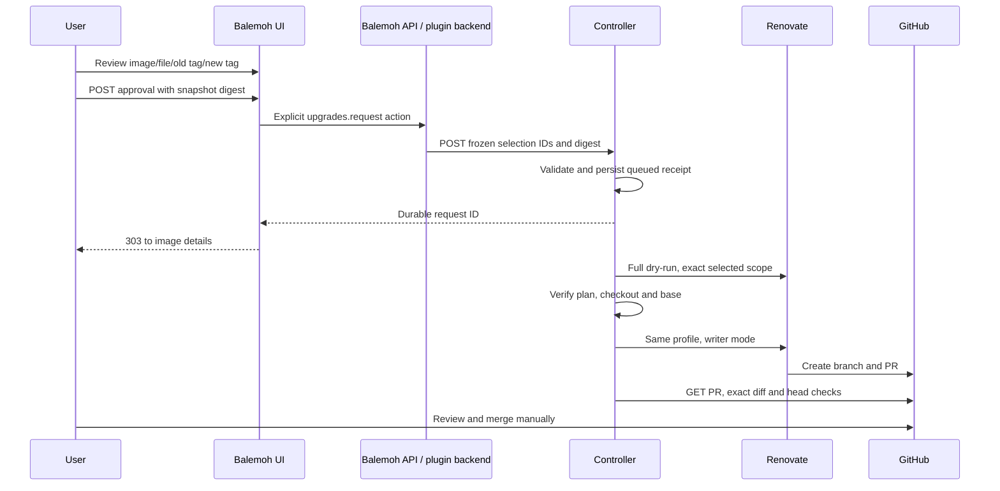

# Selected upgrade requests

Status: request-capable prereleases published; homelab writer migration pending, 2026-11-01. Production remains read-only. See [validation results](https://github.com/guilycst/home-lab/blob/0b0a6ae801053f4c0458cdf66d50ced0fb9f855c/docs/specs/spec-001-balemoh-image-upgrades/request-controller-results.md). The hosted Renovate integration has not been retired. See [writer migration](https://github.com/guilycst/home-lab/blob/0b0a6ae801053f4c0458cdf66d50ced0fb9f855c/docs/specs/spec-001-balemoh-image-upgrades/writer-migration.md) for the separate cutover.

## Components

The existing hourly collector continues to run pinned Renovate OSS in full dry-run. The plugin retains its normalized snapshot, displays candidates and publishes configured advisory notifications. Collection never creates branches or PRs.

A private request controller accepts an approved candidate and owns durable request records. One worker runs Renovate for that request, then reconciles its PR through GitHub GET endpoints. It also serves the existing authenticated `/snapshot.json` endpoint, replacing the standalone snapshot-server process at migration. The collector, snapshot PVC and private Service stay plugin-owned.

## SDK and host contract

The optional `data.action/v1` capability is separate from `data.query/v1`. A manifest declares `actions` with input/output JSON schemas. A backend optionally implements `ActionHandler`; existing read-only handlers remain compatible. Query never invokes an action.

The API exposes authenticated `POST /api/v1/plugins/{pluginId}/connections/{connectionId}/actions/{actionId}`. Both the capability and named action must be explicitly granted for an enabled, ready connection. The UI callback can invoke an action only during a page POST; GET and widget invocations cannot mutate. Host validation bounds and validates input/output on each side of the RPC.

The request confirmation page uses a native POST with an announced submitting state. Success uses 303 Post/Redirect/Get to details with the actual durable request ID. Errors retain the console shell, image identity and filters. The server derives repository, tags, branch and URLs from retained data; form fields cannot supply them. Stale snapshot digests return conflict before invoking the controller.

This requires [published SDK alpha.4](https://github.com/araihu/balemoh/releases/tag/plugin-sdk/v0.0.1-alpha.4) and the action-capable host. Fresh public-module checks built independent UI/backend consumers without replacements. The plugin pins the published checksum. Host and plugin implementation PRs remain open for manual merge; artifact publication does not activate the homelab writer.

## Controller HTTP contract

| Endpoint | Credential | Behavior |
|---|---|---|
| GET /healthz | none, private service | Process health |
| GET or HEAD /snapshot.json | reader bearer | Bounded current normalized snapshot |
| GET /v1/requests | reader bearer | Enabled flag and retained request records |
| POST /v1/requests | separate action bearer | Validate selection and persist or return existing receipt |

Submission contains only `dependencyId`, `candidateId` and `snapshotDigest`, each a SHA-256 identity. Default maximum snapshot age is 3600 seconds; the staged homelab controller allows 7200 seconds for its hourly collection. Foreign repositories, changed observations, unsupported candidates, unknown fields, stale data and conflicting active requests are rejected. The controller has one configured repository/base and one expected PR author.

The canonical request ID includes repository identity, approved base commit, dependency ID and candidate ID. The owned branch is `balemoh-renovate/<request-id>`. Concurrent identical submissions return one receipt. A different candidate in the same image/file group cannot run while another request is queued, executing, open, draft or ambiguous. A blocked preflight can be reviewed again only after a new collection digest. Repeating a terminal receipt does not recreate its PR.

## States and persistence

| State | Meaning |
|---|---|
| queued | Durable request accepted |
| running | Durable marker written before starting engine |
| awaiting_pr | Legacy/transient receipt awaiting its next read-only outcome check |
| open / draft | Verified owned PR observed |
| closed | PR closed without merging |
| merged | GitHub reports merged |
| blocked | Preflight failed before a possible write |
| needs_attention | Interrupted or ambiguous write; automatic replay forbidden |

Records persist as bounded JSON files using fsync, atomic rename and directory fsync. A lifetime advisory flock excludes a second controller. Invalid restored records fail startup. Capacity is at most 512 records, additionally bounded by a 512 KiB admission budget with per-record headroom for PR/status growth; no silent eviction. Each record retains its approved source selection, observation digest, timestamps, PR head and last observed checks. Reconciliation handles at most ten records per cycle, oldest observation first. Merged receipts are retained without further polling.

After restart, a surviving running marker becomes needs_attention. The controller first looks for the exact existing PR and orphan branch; it never blindly repeats an uncertain write. GitHub failures retain prior PR evidence and show an explicit tracking-unavailable warning.

A writer's zero exit code does not confirm PR creation. The controller immediately verifies the owned PR. If none is observed, it inspects the branch and records `needs_attention` with `pr_not_created`, `branch_exists_without_pr` or `pr_observation_unavailable`. Existing `awaiting_pr` receipts take the same bounded transition on their next poll, even with the writer disabled. No unconfirmed write is automatically replayed. A late verified PR still replaces the review-required status through read-only reconciliation.

## Execution and association invariants

1. Writer defaults disabled. Read/action bearers differ; GitHub read and dedicated writer credentials remain server-side. The BFF has neither controller nor GitHub credentials.
2. Executable scope covers unpinned tag major/minor/patch upgrades and the SHA-256 pinned cases in [Spec 002](spec-002-pinned-image-requests/spec-002-pinned-image-requests.md), from Kubernetes, Docker Compose and Dockerfile managers. First-time pinning, digest removal, Helm, custom and ambiguous file/image selections remain advisory. Some valid tag declarations may conservatively fail exact-content verification.
3. Renovate is pinned to 44.197.0 and the collector's immutable base image. It receives a controlled environment, fresh temporary workspace, one repository, one file, one manager, an exact package and approved target tag/digest. Scripts, plugins, dashboards, automerge, platform automerge and stale-branch pruning are disabled.
4. A full dry-run must contain exactly the approved branch and matching source occurrences, with no foreign candidate or collection problem. Its branch result must be `done`, `pr-created` or `no-work`. Pinned Renovate can return `no-work` because full dry-run creates no commit SHA; it is admitted only in this preflight gate when the exact approved branch, source occurrences and upgrade pass every check. Deferred, failed, missing, unknown and policy-limited results block before the writer under `plan_not_actionable`. Normalization must reproduce the approved dependency and candidate IDs. The retained checkout and GitHub base must match the approval. A blocked request can be reviewed again after a fresh collection; limits, schedules and approval policy are not bypassed.
5. The writer uses the same profile as preflight with only dry-run disabled. For pinned requests, a native post-lookup `matchJsonata` rule disables updates with a missing/different target digest, wrong tag presence/value or wrong update type before branch generation. There is no dashboard mutation, checkbox approval or merge command. Existing repository policy remains required.
6. PR association requires exact repository, base, owned branch, author, URL and one approved file. GitHub Contents must show exactly the approved complete image reference replacements against the frozen base. Unexpected diffs are not attributed to the request.
7. Check results belong to the observed head. Empty, truncated, skipped, neutral or unknown evidence cannot produce passing. A head change during observation rejects the fresh PR association and marks tracking unavailable. Retained PR checks become unknown; a later poll must verify the current head and its exact diff before association resumes. Passing checks do not establish merge eligibility.
8. GitHub credentials are reread from files for token refresh. Raw engine output stays in private disposable storage and is removed. Public failures contain controlled phase/reason codes, not credentials or raw report content.

The base can change between its last preflight check and Renovate's write. Post-write checks and diff verification detect that race but cannot undo an external branch already created. Such writes require operator review. Manual merge and a separate single-writer handover remain mandatory.

## Acceptance ledger

| State/request | Expected response | Context/destination | External effect |
|---|---|---|---|
| GET confirmation | 200, no action RPC | Exact image/file/tags and filters | 0 |
| Approved current POST | 303, durable receipt | Image details, receipt ID, filters | One queued request |
| Repeated identical POST | Same receipt | Same request/details | Still one request/execution |
| Stale tab POST | 409 in shell, focus error | Current selection and return link | 0 new effects |
| Missing action grant | 403 | In-shell recovery | 0 |
| GET/widget action callback | permission_denied | No action invocation | 0 |
| Foreign fields/selection | 400 or 409 | Exact retained selection | 0 |
| API/controller unavailable | 503 in shell | Status-first retry advice | 0 confirmed effects; inspect receipt |
| Interrupted worker/restart | needs_attention | Retained receipt/PR lookup | No replay |
| Closed/merged receipt resubmission | Same receipt | Terminal status | No new execution |

Automated tests exercise admission, role separation, concurrent deduplication, storage ownership/restart, scope rejection, SDK POST-only transport, host grants, UI conflict/recovery, lifecycle and conservative checks. Browser acceptance and real-engine receipts are recorded separately; untested rows must not be described as qualified.

Published alpha.5 completed the [isolated Kubernetes writer qualification](../qualification/alpha5-writer/README.md): one selected-file PR, duplicate approval deduplication and retained tracking after restart. A [separate fixture-only PAT proof](../qualification/alpha5-pr-ci/README.md) verified automatic `pull_request` CI, successful Checks/commit status on the exact PR head, and retained passing tracking after restart. These receipts do not run the production workflows, qualify other managers or authorize writer cutover.
